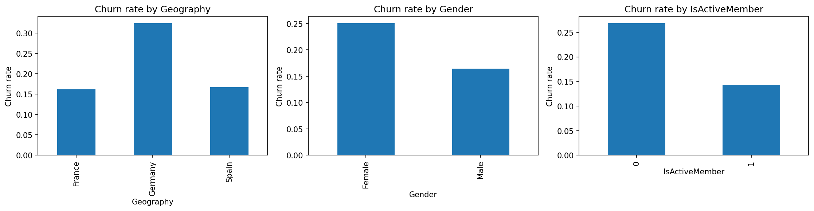
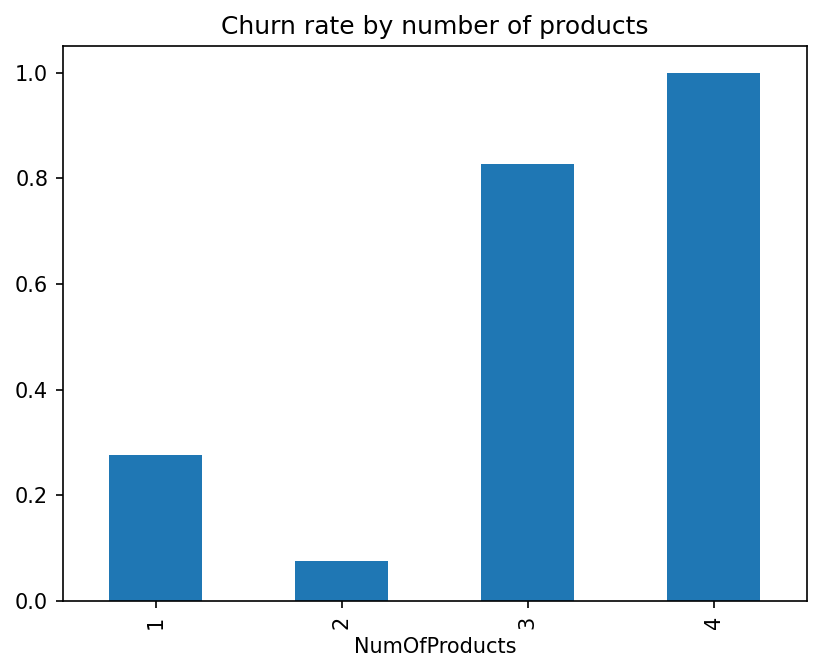
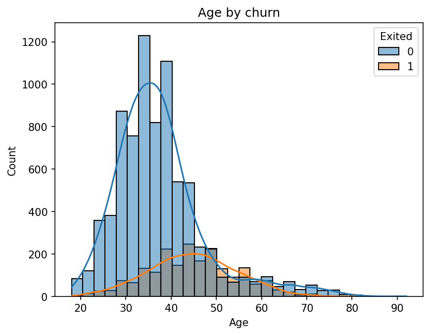
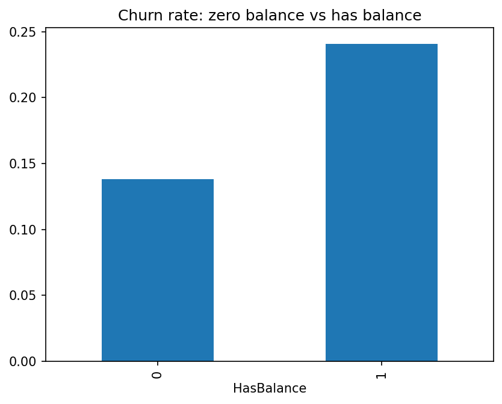

# Bank Customer Churn Prediction

## Business question
Which customers are likely to leave, and why?

## Data
Kaggle "Bank Customer Churn Prediction" dataset: 10,000 customers, no missing values. Target: `Exited` (1 = left). Overall churn rate: 20.4%.
Source: [Bank Customer Churn Prediction (Kaggle)](https://www.kaggle.com/datasets/shantanudhakadd/bank-customer-churn-prediction)

## Approach
1. Dropped ID columns (`RowNumber`, `CustomerId`, `Surname`).
2. Explored churn rates by group.
3. Found that 36% of customers have a zero balance and churn less, so added a `HasBalance` flag.
4. One-hot encoded `Geography` and `Gender`.
5. Trained Logistic Regression and Random Forest (80/20 split, stratified, balanced class weights).
6. Judged models on precision and recall for churners, not accuracy, because classes are imbalanced.

## Key findings
- **Germany** churns about twice as much as France or Spain (32% vs 16-17%).
- **Women** churn more than men (25% vs 16%).
- **Inactive members** churn more (27% vs 14%).

- **Number of products** is non-linear: 2 products is safest (8% churn), 1 product is 28%, and 3-4 products almost all leave (83% and 100%).

- **Churners are older** (average 45 vs 37).

- **Balance:** churners looked richer on average, but this was misleading. Among customers with a balance, churners and stayers hold almost the same amount. The real signal is having a balance at all.

## Model results (churn class)
| Model | Precision | Recall | F1 |
|---|---|---|---|
| Logistic Regression | 0.37 | 0.70 | 0.49 |
| Random Forest (cutoff 0.5) | 0.77 | 0.45 | 0.57 |
| Random Forest (cutoff 0.4) | 0.68 | 0.55 | 0.61 |
| Random Forest (cutoff 0.3) | 0.57 | 0.65 | 0.61 |

The Random Forest performs best overall. Lowering the decision cutoff trades precision for recall. A cutoff of **0.4** gives a balanced result: it catches 55% of leavers, and about 7 in 10 flagged customers really leave. A bank with cheap retention offers could choose 0.3 to catch more.

## What drives churn
Built-in Random Forest importance overstated salary and credit score (continuous columns get inflated scores). **Permutation importance** on the test set gave a more reliable ranking:

1. Age
2. Number of products
3. Geography (Germany)
4. Active membership
5. Balance

Salary, credit score, tenure, and card ownership had almost no effect. Feature importance shows what the model relies on, not what causes churn.

## Recommendations
1. Target retention at older customers and those with one product.
2. Investigate why German customers leave at twice the rate.
3. Re-engage inactive members.
4. Review customers with 3-4 products, who almost all leave.

## Limitations
- Single snapshot, no time dimension.
- No cost data, so the cutoff is a judgment call.
- Small groups (3-4 products) make those rates less reliable.

## Tools
Python, pandas, scikit-learn, matplotlib, seaborn.
